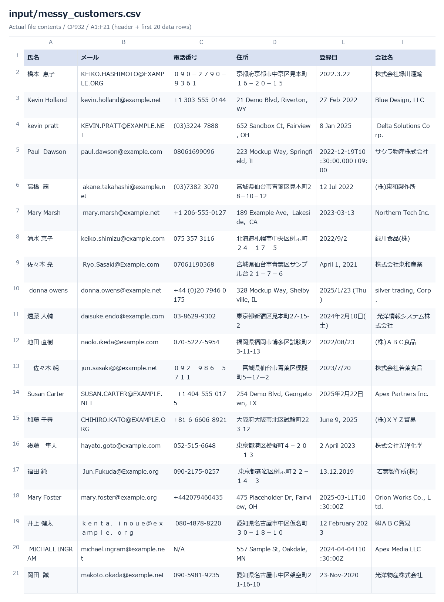
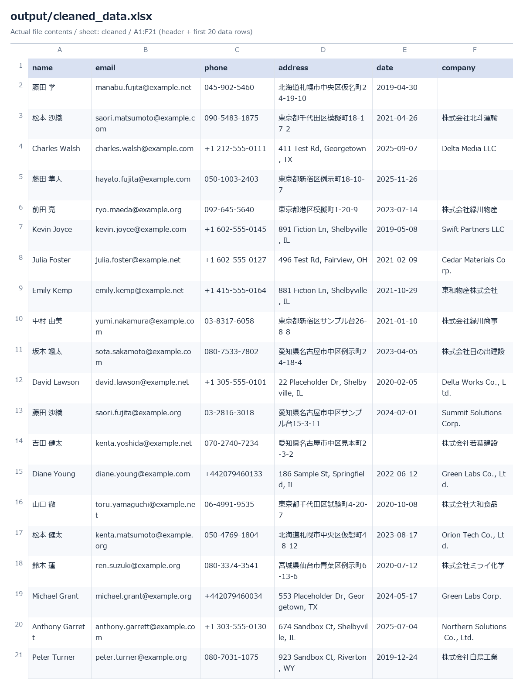
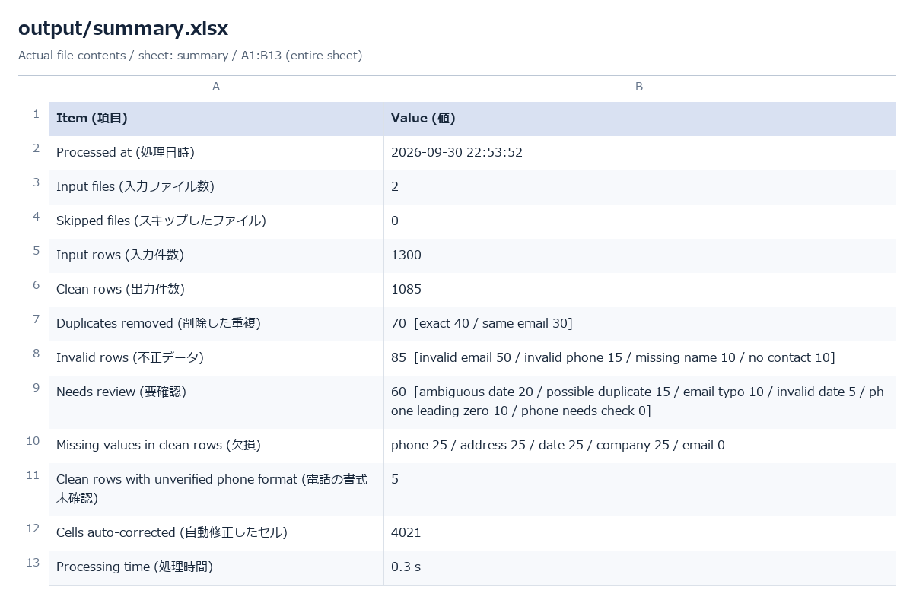

# Excel / CSV データクリーナー

> **Self-initiated Portfolio Project — all data is fictional.（自主制作のポートフォリオです。データはすべて架空です）**
> このリポジトリ内の氏名・会社名・住所・電話番号・メールアドレスはすべて架空のものです
> （メールのドメインは `example.com` / `.net` / `.org`、電話番号は架空用の番号帯）。実際の顧客データは一切使っていません。

English: [README.md](README.md)

汚れた顧客リスト（CSV / Excel）を読み込み、整形・**データ検証**・**重複削除**を行い、
「きれいなデータ」「不正データ」「要確認データ」「処理サマリー」を別ファイルで出力する Python 自動化ツールです。
**Excel データ整理**・**CSV クリーニング**・**CRM データのクリーンアップ**（取り込み前・メール配信前・納品前）に使えます。

## Problem（課題）

CRM・フォーム・古い Excel から出力した顧客リストには、決まったパターンの汚れがあります。
全角／半角の混在、バラバラな電話番号表記、`2024/1/5` / `Jan 5, 2024` / `03/04/2024` などバラバラの日付、
メールの打ち間違い（`gmial.com`）、`(株)` / `㈱` / `Inc` / `Co.,Ltd` といった会社名の表記ゆれ、重複行。
手作業では時間がかかり、見落としも出ます。

## Solution（解決方法）

`python main.py input/` で、フォルダ内のすべての CSV/XLSX を一括処理し、次のファイルを出力します。

- `cleaned_data.xlsx` / `.csv` — そのまま使える行
- `errors.xlsx` — 不正データ（`invalid`）と削除した重複（`duplicates`）。理由コード付き
- `needs_review.xlsx` — ツールが推測しなかった行（修正候補付き）
- `change_log.xlsx` — 変更したセルの一覧（変更前 → 変更後）
- `summary.txt` / `summary.xlsx` — 件数サマリー（英語＋日本語ラベル）
- `process.log`

基本方針は **「確信できる変換だけ行う」** です。あいまいなもの（`03/04/2024` のような日付、先頭の0が消えたかもしれない電話番号）は
勝手に直さず、値をそのまま残して `needs_review` に回します。

## Features（機能）

- CSV（UTF-8 / Shift_JIS(cp932) を自動判定）と Excel（`.xlsx` の先頭シート）を読み込み。フォルダ一括処理に対応
- 日本語・英語の列名ゆれ（`氏名`、`Full Name`、`E-mail`、`Tel` など）を `config/column_aliases.json` で吸収
- 氏名・メール・電話（日本／北米／海外）・日付・住所・会社名の整形
- メール・電話・日付の検証。メールドメインの典型的な打ち間違いは修正候補を提示
- 完全一致とメール一致の重複を除去。**重複候補は消さずに要確認へ**
- 入力ファイルは絶対に書き換えない（処理前後の SHA-256 を比較）。出力先が入力ファイルと一致する場合は実行しない
- 同じ入力なら同じ出力（処理日時・処理時間を除く）
- 1,300行を1秒未満で処理

## Before & After（処理前後）

下の数字は `output/summary.txt`（`input/` の合成データで実行した結果）から転記したものです。
**サンプルは意図的にエラーを仕込んだ合成データです。ツールの動作を示す数字であり、実際の顧客ファイルの内訳を表すものではありません。**

| | 処理前（元ファイル） | 処理後 |
| --- | ---: | ---: |
| 行数 | 1,300 | **きれいなデータ 1,085** |
| 重複 | 70件が混在 | 70件を除外：完全一致 40 / メール一致 30 |
| 不正データ | 85件が混在 | 85件を理由付きで分離 |
| 要確認 | 判別できない | 60件を修正候補付きで分離 |
| 表記ゆれ | — | 4,021セルを自動修正。すべて `change_log.xlsx` に記録 |

「自動修正」の例（すべてテストで確認済み）：

| 列 | 処理前 | 処理後 |
| --- | --- | --- |
| 氏名 | ` JOHN  CARTER `、`山田　太郎` | `John Carter`、`山田 太郎` |
| メール | `ｔａｒｏ＠ｅｘａｍｐｌｅ．ｃｏｍ`、`John.Carter@Example.com` | `taro@example.com`、`john.carter@example.com` |
| 電話 | `09012345678`、`０９０－１２３４－５６７８`、`+81 90-1234-5678`、`(415) 555-0132`、`+44 (0)20 7946 0958` | `090-1234-5678`（3件とも）、`+1 415-555-0132`、`+442079460958` |
| 日付 | `2024/1/5`、`2024年1月5日(金)`、`5-Jan-2024`、`2024-01-05T10:30:00Z`、Excel の日付セル | `2024-01-05` |
| 会社名 | `(株) ABC商事`、`ＡＢＣ商事(株)`、`acme trading inc`、`Sakura Foods Co.,Ltd` | `株式会社ABC商事`、`ABC商事株式会社`、`Acme Trading Inc.`、`Sakura Foods Co., Ltd.` |
| 住所 | `１－２－３`、`1ー2ー3` | `1-2-3` |

スクリーンショット（実際のサンプル実行ファイルから描画したもの）：





## How it works（仕組み）

```text
input/*.csv, *.xlsx
   └─ io.py        読込（文字コード判定・列名の対応付け・全セルを文字列で読む）
   └─ normalize.py セル単位の整形（NFKC・氏名・メール・電話・日付・住所・会社名）
   └─ validate.py  行単位の検証 → invalid / needs_review の理由、soft issue
   └─ dedupe.py    完全一致 → メール一致 → 重複候補
   └─ report.py    xlsx / csv / txt の出力
   └─ pipeline.py  全体の流れ・ログ・安全装置・件数検算
```

すべての行は、優先順位 invalid > duplicate > needs_review > clean で **4区分のどれか1つ** になり、
実行のたびに `clean + duplicates + invalid + needs_review == 入力件数` を検算します。

## How to run（実行方法）

Python 3.10 以上が必要です。

**Windows（PowerShell）** — `py` と `python` のどちらか動くほうを使ってください：

```powershell
py -m pip install -r requirements.txt
py scripts/generate_sample_data.py        # 任意：架空のサンプルデータを再生成
py main.py input/                         # フォルダ一括
py main.py input/messy_customers.csv      # 1ファイル
py main.py input/ --output output/ --date-order mdy
py scripts/verify_against_ground_truth.py
py -m unittest discover -s tests -v
```

**macOS / Linux：**

```bash
python3 -m pip install -r requirements.txt
python3 scripts/generate_sample_data.py
python3 main.py input/
python3 main.py input/ --output output/ --date-order mdy
python3 scripts/verify_against_ground_truth.py
python3 -m unittest discover -s tests -v
```

オプション：`--output DIR`（既定 `output/`）、`--date-order mdy|dmy`（`03/04/2024` の読み方。指定しないと `needs_review`）。
終了コード：`0` 正常、`1` 読める入力なし、`2` すべてのファイルで必須列（`name`・`email`）が無い。

**Excel で開くファイル：** **`cleaned_data.xlsx`** を開いてください。`cleaned_data.csv`（UTF-8 BOM 付き）は他システムへの取り込み用です。
CSV を Excel で直接開くと、`+1 …` や `+44…` の電話番号が数式や数値として解釈されることがあります。

## Sample input（サンプル入力）

`scripts/generate_sample_data.py`（乱数シード固定・毎回同じ内容）が次を作ります：

- `input/messy_customers.csv` — 1,000行、Shift_JIS、日本語ヘッダー
- `input/crm_export_2.xlsx` — 300行、英語ヘッダー（表記ゆれ）、日付セル・数値の電話セルを含む
- `input/ground_truth.json` — 仕込んだ内容と、各行の期待結果

仕込んだ問題：完全重複 40、メール一致の重複 30、重複候補 15、不正メール 50、メールドメインの打ち間違い 10、曖昧な日付 20、
存在しない日付 5、不正電話 15、氏名なし 10、連絡先なし 10、先頭0が消えた電話 10、任意項目の欠損 約100、ほとんどの行に表記ゆれ。

## Sample output（サンプル出力）

コミット済みの `output/` は、そのデータに `python main.py input/` を実行した結果です：
[`cleaned_data.xlsx`](output/cleaned_data.xlsx)、[`errors.xlsx`](output/errors.xlsx)、
[`needs_review.xlsx`](output/needs_review.xlsx)、[`change_log.xlsx`](output/change_log.xlsx)、
[`summary.txt`](output/summary.txt)。

**Verification（検証）：** [`output/verification_report.md`](output/verification_report.md) は出力を仕込んだ正解データと照合した結果です。
これは **合成データでの整合性確認** であり（ジェネレーターとルールを同じ作者が書いています）、実データでの精度を保証するものではありません。
実際のファイルにはサンプルに無い種類の汚れが含まれます。

## Validation rules（検証ルール）

| 区分 | 理由コード | 出力先 |
| --- | --- | --- |
| invalid（不正） | `missing_name`、`invalid_email`、`invalid_phone`、`no_contact`（メールも電話も無い） | `errors.xlsx` › `invalid` |
| duplicate（重複） | `duplicate_exact`（6列すべて一致）、`duplicate_email` | `errors.xlsx` › `duplicates` |
| needs_review（要確認） | `email_domain_typo`、`ambiguous_date`、`invalid_date`、`possible_duplicate`、`phone_leading_zero`、`phone_needs_check` | `needs_review.xlsx` |
| clean（正常） | 上記以外。任意項目の欠損は `issues` 列に記録（`missing_phone` など、`phone_format_unverified`） | `cleaned_data.xlsx` / `.csv` |

- **重複：** ファイルはファイル名順、行は行番号順に処理し、**最初に出てきた行を残して** 後の行を重複とします。**重複候補**（氏名＋会社が同じでメールが違う、または電話が同じでメールが違う）は **自動では消さず** `needs_review` に回します。
- **電話：** 日本の番号は書式が確実なときだけ整形します。`03`/`06` 以外の10桁固定電話で区切りが無いもの（例 `0467123456`）は、市外局番の桁数が分からないため数字のまま残し、`phone_format_unverified` を付けます。区切り無しの `9012345678`（または `90-1234-5678`。北米の番号は 3-3-4 で書くため）は「Excel で先頭の0が消えた携帯」か「北米番号」か判断できないため `phone_leading_zero` とし、`suggestion` に両案を出します。内線や複数番号が1セルにある場合は `phone_needs_check` です。
- **日付：** 出力は `YYYY-MM-DD`。`03/04/2024` は、日が12を超える場合か `--date-order` の指定が無い限りあいまいとして扱います。
- サマリーの内訳は **理由ごとに数える** ため、1行が複数の理由を持つ場合、内訳の合計が区分の件数を超えることがあります。

## Tech stack（技術構成）

Python 3.10 以上（開発は 3.14）、`pandas`、`openpyxl`。それ以外は標準ライブラリ（`argparse`、`logging`、`unicodedata`、`re`、`unittest`）のみ。
電話番号ライブラリ・ネットワークアクセス・LLM は使っていません。

## Limitations（制限事項）

- 日本の固定電話の **市外局番の桁数は推測しません**。区切りが無ければ数字のまま残します。
- 区切り無しの10桁で `50/70/80/90` 始まりは「先頭の0が消えたかもしれない」として扱います（該当する市外局番の北米番号を区切り無しで書くと要確認になります）。
- 和暦（令和・平成など）には対応していません。
- **タイムゾーン変換はしません。** `2024-01-05T23:30:00-05:00` は日付部分 `2024-01-05` だけを使います。
- 住所は表記の統一（全角数字・ハイフン類）のみ。**住所が実在するか・正しいかは判定しません。**
- 氏名は姓名に分割しません。Excel は先頭シートのみ。未知の列は警告を出して捨てます。
- PDF には対応していません。

## Future improvements（今後の改善案）

- 顧客ごとの列名エイリアス設定・出力列のカスタマイズ
- 全シートの読込、未知の列を出力の末尾に残す
- メールドメインの打ち間違い辞書・会社名の法人格ルールを設定化
- 郵便番号などを使った住所チェック（住所データベースが必要）
- 定期的な取り込み向けの簡易 GUI やスケジュール実行

## Contact（連絡先）

データ整理のご相談は [CrowdWorks プロフィール URL] / [Upwork プロフィール URL] からお願いします。
