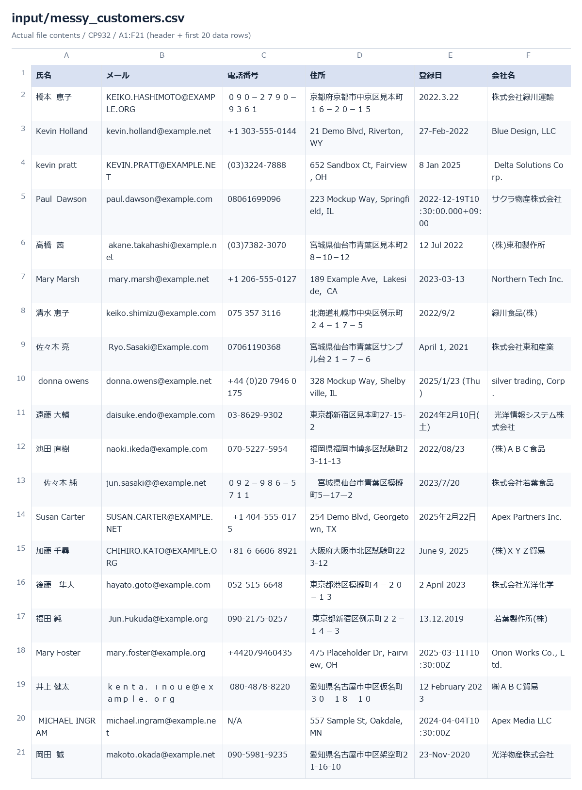
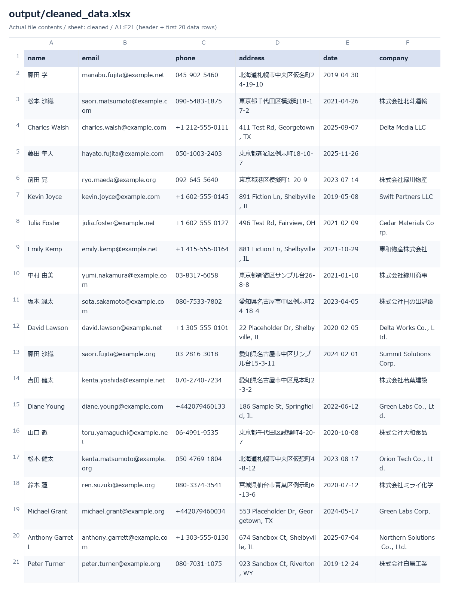
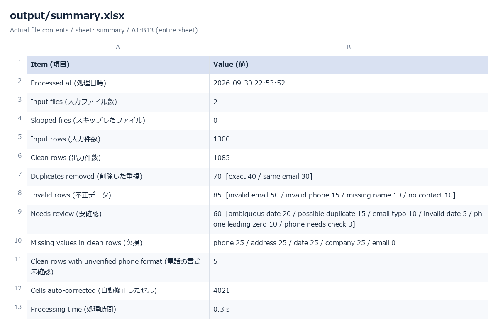

# Excel / CSV Data Cleaner

> **Self-initiated Portfolio Project — all data is fictional.**
> Every name, company, address, phone number and e-mail in this repository is made up
> (e-mail domains are `example.com` / `.net` / `.org`; phone numbers use fictional ranges).
> No client data was used.

日本語版: [README.ja.md](README.ja.md)

A small Python automation tool for **Excel data cleaning** and **CSV cleaning**: it reads messy
customer lists (CSV / Excel), normalizes them, runs **data validation**, performs **duplicate
removal**, and writes separate files for clean, invalid, needs-review data plus a processing summary.
Typical use: **CRM cleanup** before an import, a mailing, or a hand-over.

## Problem

Customer lists exported from CRMs, forms, or old spreadsheets are messy in predictable ways:
full-width vs half-width characters, phone numbers in many different styles, dates like
`2024/1/5` / `Jan 5, 2024` / `03/04/2024`, e-mail typos (`gmial.com`), company suffixes
`(株)` / `㈱` / `Inc` / `Co.,Ltd`, and duplicate rows. Cleaning them by hand is slow and error-prone.

## Solution

`python main.py input/` processes every CSV/XLSX in a folder and produces:

- `cleaned_data.xlsx` / `.csv` — rows that are safe to use
- `errors.xlsx` — `invalid` rows and removed `duplicates`, each with a reason code
- `needs_review.xlsx` — rows the tool refuses to guess about, with a suggestion
- `change_log.xlsx` — every cell that was changed (before → after)
- `summary.txt` / `summary.xlsx` — counts, in English with Japanese labels
- `process.log`

The guiding rule: **only convert what can be converted with certainty.** Anything ambiguous
(a date like `03/04/2024`, a phone number that may have lost its leading 0) is never
"fixed" silently: the value is kept as it was and the row goes to `needs_review`.

## Features

- Reads CSV (UTF-8 or Shift_JIS/cp932, auto-detected) and Excel (`.xlsx`, first sheet); a whole folder at once
- Maps column names in Japanese and English spelling variants (`氏名`, `Full Name`, `E-mail`, `Tel` …) via `config/column_aliases.json`
- Normalizes names, e-mails, phone numbers (Japan / North America / international), dates, addresses, company names
- Validates e-mails, phones and dates; flags known e-mail domain typos and suggests the correction
- Removes exact duplicates and same-e-mail duplicates; flags *possible* duplicates instead of deleting them
- Never modifies input files (SHA-256 checked before and after), refuses to overwrite an input file
- Deterministic: the same input gives the same output (except timestamps)
- 1,300 rows are processed in well under a second

## Before & After

Figures below are copied from `output/summary.txt` (the sample run on the synthetic data in `input/`). **The sample data is synthetic: it contains errors that were planted
on purpose (see "Sample input"), so these numbers show what the tool does, not what a real client file looks like.**

| | Before (raw files) | After |
| --- | ---: | ---: |
| Rows | 1,300 | **1,085 clean** |
| Duplicates | 70 hidden in the data | 70 removed: exact 40 / same e-mail 30 |
| Invalid rows | 85 mixed in | 85 set aside with reasons |
| Needs a human look | not identifiable | 60 rows with suggestions |
| Inconsistent formatting | — | 4,021 cells auto-corrected, all listed in `change_log.xlsx` |

Examples of what "auto-corrected" means (all covered by the tests):

| Column | Before | After |
| --- | --- | --- |
| name | ` JOHN  CARTER `, `山田　太郎` | `John Carter`, `山田 太郎` |
| email | `ｔａｒｏ＠ｅｘａｍｐｌｅ．ｃｏｍ`, `John.Carter@Example.com` | `taro@example.com`, `john.carter@example.com` |
| phone | `09012345678`, `０９０－１２３４－５６７８`, `+81 90-1234-5678`, `(415) 555-0132`, `+44 (0)20 7946 0958` | `090-1234-5678` (×3), `+1 415-555-0132`, `+442079460958` |
| date | `2024/1/5`, `2024年1月5日(金)`, `5-Jan-2024`, `2024-01-05T10:30:00Z`, Excel date cell | `2024-01-05` |
| company | `(株) ABC商事`, `ＡＢＣ商事(株)`, `acme trading inc`, `Sakura Foods Co.,Ltd` | `株式会社ABC商事`, `ABC商事株式会社`, `Acme Trading Inc.`, `Sakura Foods Co., Ltd.` |
| address | `１－２－３`, `1ー2ー3` | `1-2-3` |

Screenshots rendered from the actual sample-run files:





## How it works

```text
input/*.csv, *.xlsx
   └─ io.py        read (encoding detection, header alias mapping, all cells as text)
   └─ normalize.py per-cell rules (NFKC, names, e-mail, phone, date, address, company)
   └─ validate.py  per-row checks → invalid / needs_review reasons, soft issues
   └─ dedupe.py    exact → same e-mail → possible duplicates
   └─ report.py    xlsx/csv/txt outputs
   └─ pipeline.py  the flow, logging, safety checks, row-count check
```

Every row ends up in exactly one of four categories (priority: invalid > duplicate > needs_review > clean),
and `clean + duplicates + invalid + needs_review == input rows` is checked on every run.

## How to run

Requires Python 3.10+.

**Windows (PowerShell)** — use `py` or `python`, whichever works on your machine:

```powershell
py -m pip install -r requirements.txt
py scripts/generate_sample_data.py        # optional: regenerate the fictional sample data
py main.py input/                         # a whole folder
py main.py input/messy_customers.csv      # one file
py main.py input/ --output output/ --date-order mdy
py scripts/verify_against_ground_truth.py
py -m unittest discover -s tests -v
```

**macOS / Linux:**

```bash
python3 -m pip install -r requirements.txt
python3 scripts/generate_sample_data.py
python3 main.py input/
python3 main.py input/ --output output/ --date-order mdy
python3 scripts/verify_against_ground_truth.py
python3 -m unittest discover -s tests -v
```

Options: `--output DIR` (default `output/`), `--date-order mdy|dmy` (how to read `03/04/2024`;
without it such dates go to `needs_review`). Exit codes: `0` ok, `1` no readable input, `2` required
columns (`name`, `email`) missing in every file.

**Which file to open:** open **`cleaned_data.xlsx`** in Excel. `cleaned_data.csv` (UTF-8 with BOM) is meant for
importing into other systems; opening a CSV directly in Excel can make it interpret phone numbers such as
`+1 …` or `+44…` as formulas or plain numbers.

## Sample input

`scripts/generate_sample_data.py` (fixed seed, always the same output) creates:

- `input/messy_customers.csv` — 1,000 rows, Shift_JIS, Japanese headers
- `input/crm_export_2.xlsx` — 300 rows, English headers with spelling variants, real date cells and numeric phone cells
- `input/ground_truth.json` — what was planted and what each row *should* become

Planted problems: 40 exact duplicates, 30 same-e-mail duplicates, 15 possible duplicates, 50 invalid e-mails,
10 e-mail domain typos, 20 ambiguous dates, 5 non-existent dates, 15 invalid phones, 10 missing names,
10 rows without any contact, 10 phone numbers whose leading 0 was lost, ~100 rows with a missing optional
value, plus formatting noise on most rows.

## Sample output

The committed `output/` folder is the result of `python main.py input/` on that data:
[`cleaned_data.xlsx`](output/cleaned_data.xlsx), [`errors.xlsx`](output/errors.xlsx),
[`needs_review.xlsx`](output/needs_review.xlsx), [`change_log.xlsx`](output/change_log.xlsx),
[`summary.txt`](output/summary.txt).

**Verification:** [`output/verification_report.md`](output/verification_report.md) compares the output with the
planted ground truth. This is a **consistency check on synthetic data** (the generator and the rules were written
by the same author), not a guarantee of accuracy on real data — real files will contain problems that are not in the sample.

## Validation rules

| Category | Reason codes | Output |
| --- | --- | --- |
| invalid | `missing_name`, `invalid_email`, `invalid_phone`, `no_contact` (no e-mail and no phone) | `errors.xlsx` › `invalid` |
| duplicate | `duplicate_exact` (all 6 columns equal), `duplicate_email` | `errors.xlsx` › `duplicates` |
| needs_review | `email_domain_typo`, `ambiguous_date`, `invalid_date`, `possible_duplicate`, `phone_leading_zero`, `phone_needs_check` | `needs_review.xlsx` |
| clean | everything else; missing optional values are noted in the `issues` column (`missing_phone`, …, `phone_format_unverified`) | `cleaned_data.xlsx` / `.csv` |

- **Duplicates:** files are processed in file-name order and rows in row order; **the first row that appears is kept**, later ones are flagged. *Possible* duplicates (same name + company with a different e-mail, or same phone with a different e-mail) are **never deleted automatically** — they go to `needs_review`.
- **Phones:** Japanese numbers are formatted only when the format is certain. A 10-digit landline that is not `03`/`06` and has no separators (e.g. `0467123456`) is left as digits with the note `phone_format_unverified`, because the area-code length cannot be known. A bare `9012345678` (or `90-1234-5678`, since US numbers are written 3-3-4) might be a mobile number whose leading 0 Excel dropped, or a US number → `phone_leading_zero` with both readings in `suggestion`. Extensions and several numbers in one cell → `phone_needs_check`.
- **Dates:** output is `YYYY-MM-DD`. `03/04/2024` is ambiguous unless a day is > 12 or `--date-order` is given.
- The summary counts **per reason**, so a breakdown can add up to more than the category total when a row has several reasons.

## Tech stack

Python 3.10+ (developed on 3.14), `pandas`, `openpyxl`; everything else is the standard library
(`argparse`, `logging`, `unicodedata`, `re`, `unittest`). No phone-number library, no network access, no LLM.

## Limitations

- Area-code length of Japanese landlines is **not guessed**: without separators the digits are kept as they are.
- Bare 10-digit numbers starting with `50/70/80/90` are treated as "maybe a lost leading 0" (so a US number with such an area code typed without separators goes to review).
- Japanese era dates (令和/平成 …) are not supported.
- Time zones are **not converted**: for `2024-01-05T23:30:00-05:00` only the date part `2024-01-05` is used.
- Addresses are only normalized in notation (full-width digits, dash variants); whether an address exists or is correct is **not checked**.
- Names are not split into family/given names; only the first sheet of an Excel file is read; unknown columns are dropped with a warning.
- PDF input is not supported.

## Future improvements

- Optional output column mapping / custom column-alias files per client
- Reading all sheets of a workbook; keeping unknown columns at the end of the output
- A configurable list of e-mail domain typos and company-suffix rules
- Postal-code based address checks (with a proper address database)
- A simple GUI or a scheduled run for recurring imports

## Contact

For data-cleaning inquiries, please reach me via [CrowdWorks profile URL] / [Upwork profile URL].
